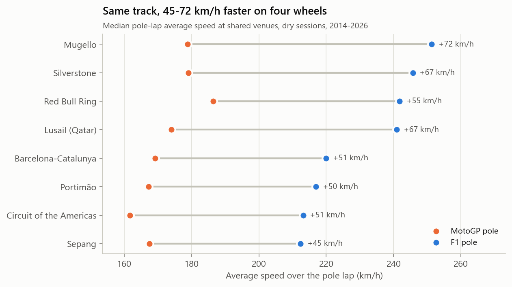
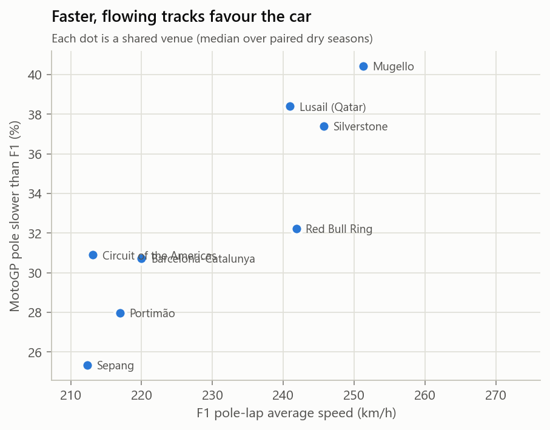
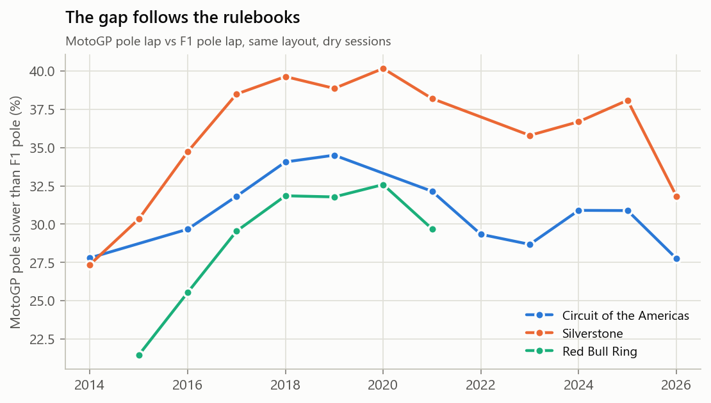
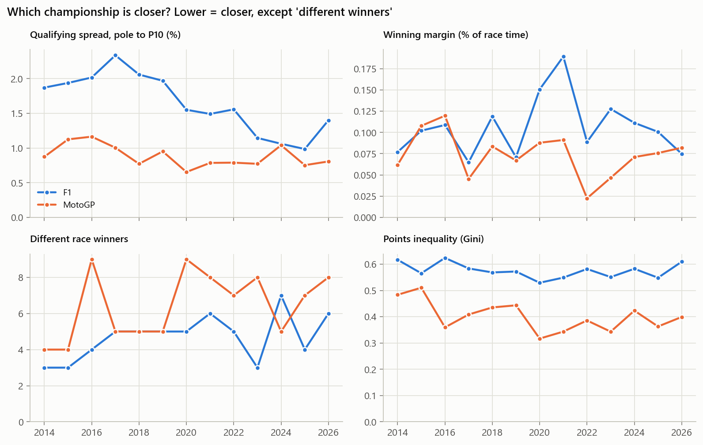

# F1 vs MotoGP

[](https://github.com/manookello/f1-vs-motogp-circuits/actions/workflows/ci.yml)


**Same tracks, very different machines.** This project compares Formula 1 and MotoGP from 2014 to
2026 (272 F1 Grands Prix, 242 MotoGP Grands Prix) and asks two questions:

1. **How much faster is an F1 car than a MotoGP bike** on the eight circuits both series use,
   and where is the gap biggest?
2. **Which championship is more competitive?** The comparison uses qualifying spread, winning
   margins, how many different winners each season has, and how evenly points are shared, with
   bootstrap confidence intervals.



## Findings

**Speed**
- On the same circuit, an F1 pole lap averages **45–72 km/h more** than a MotoGP pole lap. A
  MotoGP pole is typically **25–40% slower** (about 20–32 seconds a lap).
- **The gap is biggest on fast, flowing tracks.** At Mugello, Silverstone and Lusail the F1
  car's downforce is worth the most. The gap is smallest at slower, braking-heavy tracks such as
  Sepang, Portimão, Barcelona and COTA. Across venues, F1 pole speed and the size of the gap have
  a Spearman correlation of 0.86 (8 venues, so treat it as indicative).
- **The gap follows the rulebooks.** It widened as F1 cars got faster up to 2020: at Silverstone
  it went from 27% to 40%. It then shrank with F1's 2022 ground-effect cars and again with the
  2026 regulations. Meanwhile MotoGP pole times kept falling, e.g. COTA from 2:02.8 in 2014 to
  2:00.1 in 2026.

<p align="center">
  
  
</p>

**Competitiveness: MotoGP is the closer championship**

| Race-level measure (median) | F1 | MotoGP | F1 − MotoGP [95% CI] |
|---|---|---|---|
| Qualifying spread, pole → P10, 2014–2026 | 1.60% | 0.83% | +0.76 pp [0.64, 0.87] |
| Qualifying spread, pole → P10, 2022–2026 | 1.19% | 0.81% | +0.38 pp [0.27, 0.50] |
| Winning margin (% of race time), 2014–2026 | 0.109% | 0.078% | +0.031 pp [0.007, 0.055] |

- **Qualifying is about twice as tight in MotoGP.** F1 has closed much of the gap since its 2022
  rules, but MotoGP is still clearly tighter.
- **Races finish closer in MotoGP** too, though that difference is smaller and noisier.
- **More riders win, and points are spread more evenly.** MotoGP averaged 6.5 different winners
  per season against 4.7 in F1. It had at least as many winners in 12 of 13 seasons and a lower
  points Gini (0.40 vs 0.58) in every season.



## Method

- **Data.**
  - F1: the [Jolpica-F1 API](https://github.com/jolpica/jolpica-f1), for results with fastest
    laps and speeds, and Q1/Q2/Q3 times.
  - MotoGP: the public results API behind motogp.com, for Q1/Q2 and race classifications and
    race fastest-lap records. This API is unofficial; the client caches every response and
    throttles requests.
- **Like-for-like laps.** The comparison uses pole laps: the fastest qualifying lap for F1, and
  the Q2 winner's lap for MotoGP.
- **Wet sessions are excluded** (33 of 514). Neither API reports qualifying weather reliably, so
  a session is treated as wet when its pole is more than 3% slower than the same race's fastest
  lap (a dry pole is always quicker), or more than 10% off the usual pole for that layout.
- **Layouts are checked from the data.** Lap length is computed as speed × lap time for each
  series. This reproduces the official lengths and exposes real differences, such as MotoGP's
  Red Bull Ring chicane from 2022, the Barcelona configurations, and the different Lusail and
  Portimão lengths. Lap-time *ratios* only use pairs where the lengths match within 0.25%.
  Speeds are compared everywhere.
- **Competitiveness.**
  - Qualifying spread and winning margin are expressed as percentages, because an F1 race lasts
    about 90 minutes and a MotoGP race about 40.
  - Race-level medians are compared with a 5,000-resample bootstrap.
  - Season-level measures are different winners, top winner's share, points Gini among regular
    starters, and title margin.

## Project structure

```
├── app/streamlit_app.py         # circuit picker, all-venue speed chart, competitiveness dashboard
├── data/processed/              # tidy tables + race summaries, venue pairs, parity metrics
├── notebooks/
│   ├── 01_data_collection.ipynb
│   ├── 02_lap_times.ipynb       # shared venues, layouts, speed gap, trends
│   └── 03_parity.ipynb          # competitiveness measures + bootstrap tests
├── reports/figures/
├── src/f1_vs_motogp/            # data clients, analysis, plots
└── tests/
```

## Quickstart

```bash
git clone https://github.com/manookello/f1-vs-motogp-circuits.git
cd f1-vs-motogp-circuits
python -m venv .venv && source .venv/bin/activate   # Windows: .venv\Scripts\activate
pip install -r requirements.txt -r requirements-dev.txt
pip install -e . --no-deps

streamlit run app/streamlit_app.py
pytest

python -m f1_vs_motogp.data        # optional: rebuild the data (cached, throttled)
```

## Limitations

- The wet-session rule misses a few damp-but-not-soaking sessions, such as F1's Imola and
  Singapore qualifying in 2022.
- Matching lap length is used as a proxy for an identical layout. Two layouts could in principle
  share a length but differ in a corner.
- Points systems and field sizes differ between the series (MotoGP scores the top 15, F1 the top
  10). Both affect the Gini, so the winners-per-season and spread measures are the cleaner
  comparison.

## Related projects

- [f1-race-outcome-predictor](https://github.com/manookello/f1-race-outcome-predictor): podium
  and finishing-order models for F1.
- [motogp-performance-analytics](https://github.com/manookello/motogp-performance-analytics):
  MotoGP eras, crashes and race-outcome models.
- [f1-tyre-strategy-analysis](https://github.com/manookello/f1-tyre-strategy-analysis): tyre
  degradation, lap-time modelling and strategy simulation.

---

Unofficial project, not associated with Formula 1, the FIA, Dorna Sports or MotoGP™.
